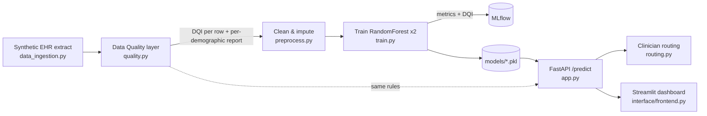

# Diabetes Demographic Plan Router

An end-to-end ML pipeline that recommends medication and meal plans for patients with type 2 diabetes, and adds two layers on top of the models:

1. **Data Quality Index (DQI).** Every record gets a deterministic 0–100 score based on how complete and valid it is. The pipeline reports the scores by demographic group, so gaps in documentation that fall unevenly across groups are visible.
2. **Clinician routing.** A rule-based layer maps each predicted care pathway to a specialty and an urgency level.

> ⚠️ All data is synthetic. This project is for teaching and demonstration only. It is not a medical device and must not be used for clinical decisions.

## Architecture



| Layer | What it does |
|---|---|
| **Ingestion** | Generates 1,200 synthetic patient records. Faults are injected on purpose: about 5% have no race recorded, 40 have no BMI, and 20 have an implausible HbA1c of 99.0. |
| **Data Quality** | Scores each row from 100 down, with penalties set in `config.yaml`. Rows scoring below `min_quality_threshold` (75) are dropped. A missing race becomes an explicit `Unknown` category rather than a guessed race. A missing BMI is filled with the median. |
| **Modeling** | Two Random Forest classifiers, one for the medication plan and one for the meal plan. Parameters, accuracy and per-demographic DQI are all logged to MLflow. |
| **Routing** | HbA1c ≥ 9.5 → Endocrinology (high urgency). Combination therapy or BMI > 32 → Internal Medicine + Dietitian. All other patients → Primary Care + Behavioral Health Coach. |

### DQI rules (`config.yaml`)

| Check | Penalty |
|---|---|
| Race missing or blank | −25 |
| BMI missing | −25 |
| BMI outside 10–80 | −25 |
| HbA1c missing or outside 3–16% | −50 |

The API scores each incoming request with the same rules (`src/quality.py`). It returns the issues it found and sets `low_quality_warning` when the score is below the threshold.

## Quickstart

```bash
python3 -m venv .venv && source .venv/bin/activate
make install          # pip install -r requirements.txt
make train            # generate data → DQI report → train → log to MLflow
make api              # FastAPI on http://localhost:8000  (docs at /docs)
make ui               # Streamlit dashboard (in a second terminal)
make mlflow           # MLflow UI for runs and DQI metrics
make test             # pytest: unit + end-to-end train/API tests
```

Example request:

```bash
curl -X POST localhost:8000/predict -H 'content-type: application/json' \
  -d '{"race_demographic":"Black/African American","age":52,"bmi":31.2,"baseline_hba1c":8.1}'
```

```json
{
  "input_record_data_quality_index": "100%",
  "data_quality_issues": [],
  "low_quality_warning": false,
  "predicted_medication_strategy": "Combination Oral (Metformin + SGLT2 Inhibitor)",
  "predicted_dietary_strategy": "Moderate Carb / Plant-Forward Mediterranean Diet",
  "recommended_provider_routing": {
    "specialty": "Internal Medicine Team & Registered Dietitian",
    "urgency": "Routine Care Path Tracking",
    "clinical_rationale": "Multi-therapeutic management required to balance metabolic baseline and structural weight metrics."
  }
}
```

## Sample baseline quality report

```
                               records  mean_dqi  missing_bmi_rate
American Indian/Alaska Native       41    94.512             0.073
Asian                              165    98.030             0.030
Black/African American             283    97.792             0.046
Hispanic/Latino                    337    98.739             0.039
Unknown                             58    73.276             0.034
White                              316    99.051             0.013

Kept 1178/1200 rows with DQI >= 75
medication_accuracy=0.996  meal_accuracy=0.996
```

## Design notes and limitations

- **Labels are clinical only.** The ground-truth plans come from HbA1c thresholds (> 9.0, > 7.5) and never from race. Race is still a model input, so you can audit whether it affects predictions. It shouldn't, and the high accuracy shows the model has learned the HbA1c rule.
- **Accuracy is high because the labels follow a simple rule.** Real EHR labels would be noisier. The point of this project is the pipeline and the quality monitoring, not model performance.
- **Missing race is never imputed as a specific race.** Filling missing race with the majority group would hide exactly the data gaps the DQI is meant to expose.
- The synthetic data has no real FHIR resources. The DQI checks fields that would map to FHIR `Patient.extension[us-core-race]`, `Observation` (BMI, LOINC 39156-5) and `Observation` (HbA1c, LOINC 4548-4).

## Project layout

```
config.yaml              pipeline, DQI weights/bounds, artifact paths
src/
  config.py              config loader + repo-root path resolution
  data_ingestion.py      synthetic messy EHR generator
  quality.py             Data Quality Index rules (shared by training + API)
  preprocess.py          DQI report, filtering, imputation, encoding, split
  train.py               training + MLflow logging
  routing.py             clinician routing rules
  app.py                 FastAPI service
interface/frontend.py    Streamlit dashboard
tests/                   pytest suite (also run in GitHub Actions)
```
