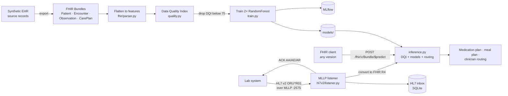

# Diabetes Demographic Plan Router

An end-to-end interoperability and ML pipeline for type 2 diabetes care. Patient data comes in as **FHIR** (five versions supported) or as **HL7 v2** lab messages over an **MLLP listener**. Every record is scored with a **Data Quality Index (DQI)**. Two models then recommend a medication plan and a meal plan, and a rule layer routes the patient to the right clinician.

> ⚠️ All data is synthetic. This is a teaching and demonstration project, not a medical device.

## Quickstart

```bash
python3 -m venv .venv && source .venv/bin/activate
make install
make run        # API :8000 + HL7 MLLP listener :2575 + dashboard :8501
```

Open http://localhost:8501 and work through the tabs in order:

| Tab | What you do |
|---|---|
| 🧭 **How it works** | Read the architecture, the DQI rules, the routing rules and a glossary |
| 1️⃣ **Data** | Generate synthetic patients. View them as the source EHR table, as FHIR Bundles, and as the flattened training table with DQI. See quality broken down by demographic group |
| 2️⃣ **Train** | Pick a quality threshold and train. See accuracy by group, feature importance, the confusion matrix and the MLflow run history |
| 3️⃣ **Predict** | Enter a patient. The app builds a FHIR Bundle in the version you choose and calls `/fhir/{version}/Bundle/$predict` |
| 4️⃣ **FHIR versions** | Compare one patient across DSTU2, STU3, R4, R4B and R5, with schema validation and a line-by-line diff |
| 5️⃣ **HL7 v2 listener** | Compose an ORU^R01, send it over MLLP and read the ACK. Inspect the inbox: raw HL7 → FHIR R4 → prediction |

Command-line equivalents: `make data`, `make train`, `make send`, `make mlflow`, `make test`.

## Architecture



### Pipeline steps

1. **Ingestion** (`src/data_ingestion.py`): generates 1,200 patients and exports each as a FHIR Bundle in `data/fhir/bundles.ndjson`. Faults are injected on purpose: about 5% have no race or ethnicity, 40 have no BMI Observation, and 20 have an implausible HbA1c of 99%.
2. **Flatten** (`src/fhir/parser.py`): pulls features out of each Bundle. Race and ethnicity come from the US Core extensions, BMI from LOINC 39156-5, HbA1c from LOINC 4548-4, age from `birthDate`, and the labels from `CarePlan.description`.
3. **Data Quality** (`src/quality.py`): see the rules below. Records scoring under 75 are excluded from training. Missing race becomes an explicit `Unknown` group, never a guessed race.
4. **Training** (`src/train.py`): trains two Random Forests. Parameters, accuracy, accuracy per demographic group, DQI per group and the quality report are all logged to MLflow.
5. **Serving** (`src/app.py`): plain JSON, FHIR in any version, and HL7 v2 all reach the same `inference.predict()`.

### Data Quality Index

| Check | FHIR source | HL7 v2 source | Penalty |
|---|---|---|---|
| Race/ethnicity not recorded | `us-core-race` / `us-core-ethnicity` extension | PID-10 / PID-22 | −25 |
| BMI missing | Observation LOINC 39156-5 | OBX 39156-5 | −25 |
| BMI outside 10–80 | `valueQuantity` | OBX-5 | −25 |
| Birth date missing | `Patient.birthDate` | PID-7 | −25 |
| HbA1c missing or outside 3–16% | Observation LOINC 4548-4 | OBX 4548-4 | −50 |

### Clinician routing

| Condition | Specialty | Urgency |
|---|---|---|
| HbA1c ≥ 9.5% | Endocrinology & Metabolic Specialist | High |
| Combination therapy predicted, or BMI > 32 | Internal Medicine + Registered Dietitian | Routine |
| Everyone else | Primary Care + Behavioral Health Coach | Preventative |

## FHIR versions

The builder (`src/fhir/builder.py`) can write the same patient in **DSTU2, STU3, R4, R4B and R5**. The parser reads all five and can tell which version a Bundle is from its structure (`detect_version`). STU3, R4B and R5 output is checked against the official schemas with [`fhir.resources`](https://pypi.org/project/fhir.resources/). R4 is checked with the R4B models, which are identical to R4 for the resources used here. DSTU2 has no maintained schema library, so it isn't schema-checked. Example files are in [`samples/fhir/`](samples/fhir).

| Element | DSTU2 | STU3 | R4 / R4B | R5 |
|---|---|---|---|---|
| Race/ethnicity extension | `argo-race` (Argonaut) | `us-core-race` | `us-core-race` | `us-core-race` |
| `Observation.category` | single object, `hl7.org/fhir/…` | list, `hl7.org/fhir/…` | list, `terminology.hl7.org/…` | same as R4 |
| Observation → Encounter | `encounter` | `context` | `encounter` | `encounter` |
| Observation note | `comments` | `comment` | `note[]` (Annotation) | `note[]` |
| Encounter → Patient | `patient` | `subject` | `subject` | `subject` |
| `Encounter.class` | code | Coding | Coding (`terminology.hl7.org`) | list of CodeableConcept |
| Completed visit status | `finished` | `finished` | `finished` | `completed` |
| Encounter time span | `period` | `period` | `period` | `actualPeriod` |
| `CarePlan.intent` | n/a | `plan` | `plan` | `plan` |
| `Bundle.timestamp` | n/a | n/a | present | present |

The tests confirm that a Bundle built for one version fails the schema of another, for example R4 checked as R5 or STU3 checked as R4.

## HL7 v2 listener

The API process also runs an **MLLP listener on `127.0.0.1:2575`**. You can turn this off with `hl7.start_with_api` in `config.yaml`, or run it on its own with `make listener`. For each message it:

1. Removes the MLLP framing (`0x0B … 0x1C 0x0D`) and splits the message into segments.
2. Accepts only **ORU^R01**. Any other type gets an `AR` (reject) ACK.
3. Maps the fields: PID-3 is the MRN, PID-7 the birth date, PID-10 race and PID-22 ethnicity (CDC codes), and OBX the LOINC results. It then builds a **FHIR R4 Bundle**.
4. Scores the DQI, predicts and routes, stores everything in `data/hl7_inbox.db`, and replies with an `AA` ACK. If the model isn't trained yet, it replies `AE`.

```bash
make send                                         # 5 random patients
python -m src.hl7v2.send --file samples/hl7/oru_r01.hl7
python -m src.hl7v2.send --file samples/hl7/oru_r01_missing_data.hl7
```

## API

| Method | Path | Purpose |
|---|---|---|
| GET | `/health` | Status, including whether the HL7 listener is up |
| POST | `/predict` | Plain JSON input: `race_demographic`, `age`, `bmi`, `baseline_hba1c` |
| GET | `/fhir/{version}/metadata` | CapabilityStatement for DSTU2, STU3, R4, R4B or R5 |
| POST | `/fhir/{version}/Bundle/$predict` | FHIR Bundle in → validation, detected version, DQI, prediction |
| POST | `/fhir/{version}/$convert` | Re-express a Bundle in another FHIR version |
| GET | `/hl7/inbox` | Messages the listener has received |

Interactive docs are at http://localhost:8000/docs.

## Design notes and limitations

- **Labels are clinical only.** Plans follow HbA1c thresholds (above 9.0 and above 7.5). The Train tab shows accuracy per group and feature importance, so you can check that demographic group isn't driving predictions.
- **Accuracy is near 100%** because the labels follow a rule. Real EHR labels would be noisier. The project is about the pipeline and the quality monitoring.
- **Hispanic/Latino is an ethnicity** in US Core and OMB standards, so it is written to `us-core-ethnicity` (PID-22), not the race extension. The model's single "demographic group" feature merges the two.
- The HL7 parser handles the segments and fields this project uses. It isn't a general HL7 v2 engine: it doesn't handle escape sequences, repeating fields or Z-segments.

## Project layout

```
config.yaml                pipeline, DQI weights, HL7 listener, artifact paths
src/
  data_ingestion.py        synthetic EHR → FHIR Bundles (NDJSON)
  terminology.py           LOINC, UCUM, CDC race/ethnicity codes
  fhir/builder.py          record → Bundle for DSTU2 | STU3 | R4 | R4B | R5
  fhir/parser.py           Bundle (any version) → record; version detection
  fhir/validate.py         official-schema validation (fhir.resources)
  fhir/versions.py         version metadata + differences table
  hl7v2/message.py         ORU^R01 build/parse, ACKs, field dictionary
  hl7v2/mllp.py            MLLP framing, threaded TCP server, client
  hl7v2/listener.py        message handler: HL7 → FHIR → DQI → predict → ACK
  hl7v2/inbox.py           SQLite message store
  hl7v2/send.py            CLI sender
  quality.py               Data Quality Index
  preprocess.py            flatten, score, clean, encode, split
  train.py                 training + MLflow
  inference.py             shared prediction (auto-reloads retrained models)
  routing.py               clinician routing rules
  app.py                   FastAPI (REST + FHIR + HL7 inbox; starts listener)
interface/frontend.py      Streamlit dashboard
samples/                   example FHIR Bundles (all versions) and HL7 messages
tests/                     65 tests: quality, routing, FHIR, HL7, end-to-end
```
